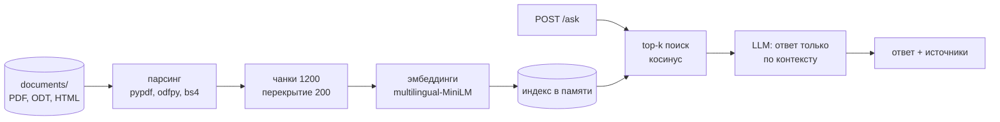

<div align="center">

# 📜 fstec-rag

**Ответы по нормативке ИБ с цитатами источников.**

FastAPI-сервис: задаешь вопрос про требования ФСТЭК или 152-ФЗ — получаешь ответ, собранный только
из найденных фрагментов документов, и сами фрагменты с оценкой релевантности.


</div>

---

## Корпус

| Документ | Формат |
|---|---|
| Приказ ФСТЭК России № 117 (требования, 2025) | PDF |
| Приказ ФСТЭК России № 21 (2013) | PDF |
| 149-ФЗ «Об информации, информационных технологиях и о защите информации» | ODT |
| 152-ФЗ «О персональных данных» | ODT |
| 98-ФЗ «О коммерческой тайне» | ODT |

Документы лежат в `documents/`; можно положить свои PDF, ODT или HTML — индекс пересоберется при запуске.

## Как это работает



1. При старте документы парсятся (`pypdf` для PDF, `odfpy` для ODT, `BeautifulSoup` для HTML)
   и режутся на чанки по 1200 символов с перекрытием 200.
2. Эмбеддинги — `sentence-transformers/paraphrase-multilingual-MiniLM-L12-v2` с L2-нормализацией;
   если модель не загрузилась (нет сети), сервис переключается на `HashingVectorizer` и продолжает работать.
3. На вопрос считается эмбеддинг, выбираются top-k (по умолчанию 4) ближайших чанков.
4. LLM получает вопрос и пронумерованные источники с жестким системным промптом: отвечать только
   по контексту, а если ответа нет — так и сказать: «Информации в документах недостаточно».
5. В ответе API — текст и источники с `doc_id`, `score` и фрагментом.

## Быстрый старт

```bash
pip install -r requirements.txt
cp .env.example .env              # и вписать ключ
uvicorn main:app --reload --env-file .env
```

- Swagger UI — `http://127.0.0.1:8000/docs`
- Health check — `http://127.0.0.1:8000/health`

### LLM

Любой OpenAI-совместимый endpoint. По умолчанию — OpenRouter:

```ini
LLM_PROVIDER=openrouter
OPENROUTER_API_KEY=your_openrouter_api_key
LLM_BASE_URL=https://openrouter.ai/api/v1
LLM_MODEL=cohere/command-r-plus
```

Или OpenAI напрямую: `OPENAI_API_KEY`, `LLM_BASE_URL=https://api.openai.com/v1`, `LLM_MODEL=gpt-4o-mini`.
Ключи берутся только из окружения и в коде не хранятся.

| Переменная | По умолчанию | |
|---|---|---|
| `DOCS_DIR` | `documents` | папка с корпусом |
| `TOP_K` | `4` | сколько фрагментов в контекст |
| `CHUNK_SIZE` | `1200` | размер чанка, символов |
| `CHUNK_OVERLAP` | `200` | перекрытие чанков |

## API

`POST /ask`

```json
{ "question": "Какие меры защиты персональных данных должен применять оператор?" }
```

```json
{
  "answer": "Текст ответа модели...",
  "sources": [
    {
      "doc_id": "Федеральный закон от 27 июля 2006 г N 152 ФЗ О персональных данных с изменениями",
      "score": 0.78,
      "snippet": "Фрагмент документа..."
    }
  ]
}
```

`GET /health`

```json
{ "status": "ok", "documents": 5, "chunks": 251, "vector_backend": "sentence-transformers" }
```

## Проверка поведения

Быстрый прогон четырех вопросов по запущенному сервису — `python scripts/test_requests.py`. Что проверять:

| Тип | Пример | Ожидаемо |
|---|---|---|
| Информационный | Что относится к персональным данным? | ответ со ссылкой на 152-ФЗ |
| Уточняющий | Какие организационные меры упоминаются в приказе ФСТЭК № 21? | ответ по конкретному документу |
| Вне корпуса | Какие требования к возврату товара в интернет-магазине? | «Информации в документах недостаточно» |

Последний тип — главный: сервис не должен «вспоминать» то, чего нет в документах.

## Ограничения

- индекс живет в памяти и пересобирается при каждом запуске;
- качество зависит от того, как распознан текст PDF/ODT;
- для генерации нужен API-ключ LLM;
- нет авторизации и истории диалогов.

## Куда развивать

- FAISS/Chroma и сохранение индекса на диск;
- reranking найденных фрагментов (cross-encoder);
- чанкинг по структуре документа (статьи, пункты) вместо фиксированного окна;
- локальная LLM через Ollama вместо облачного API;
- тесты и Dockerfile.

## Лицензия

Код — [MIT](LICENSE). Тексты нормативных документов в `documents/` — официальные документы, не охраняются
авторским правом (ст. 1259 ГК РФ) и лицензией не покрываются.
